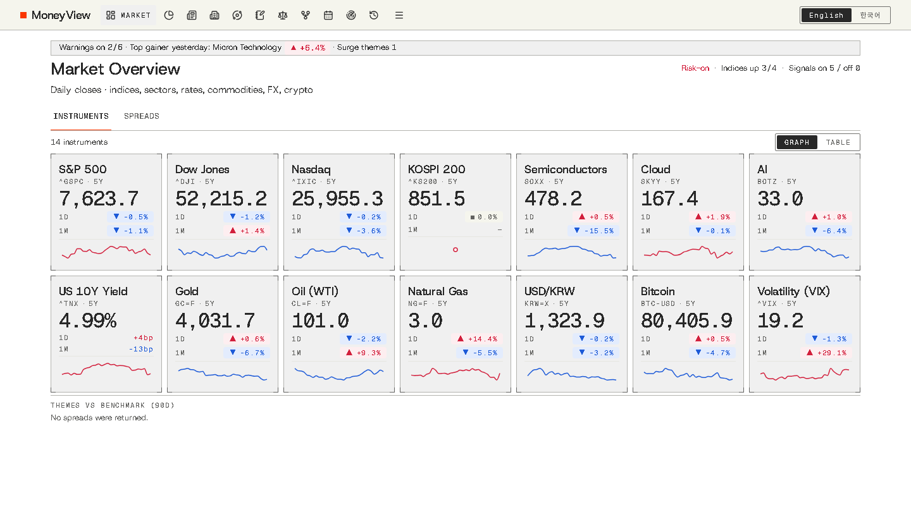
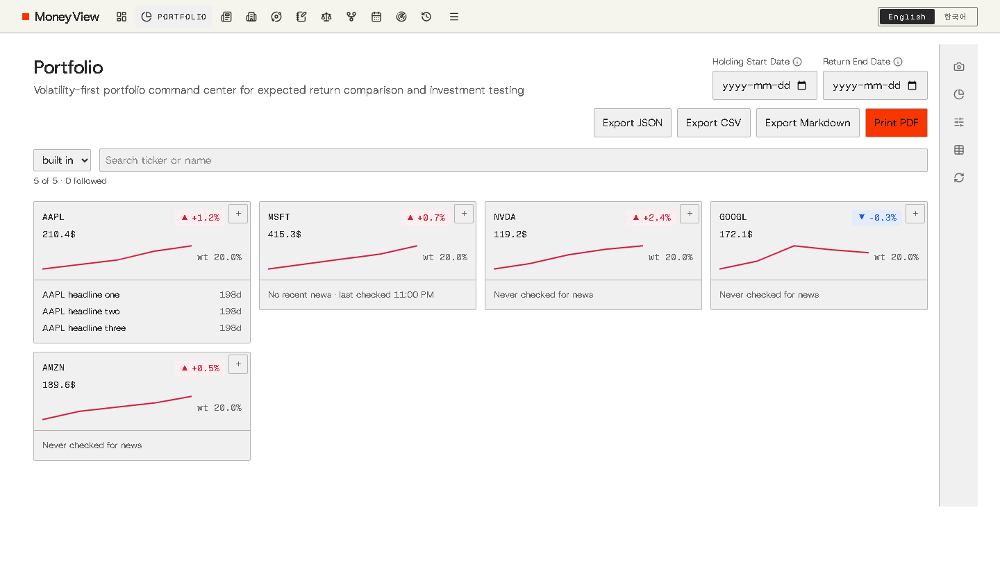
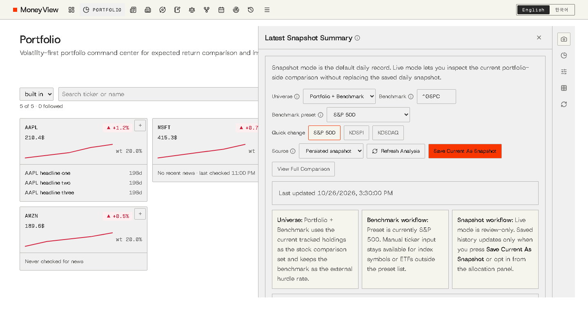
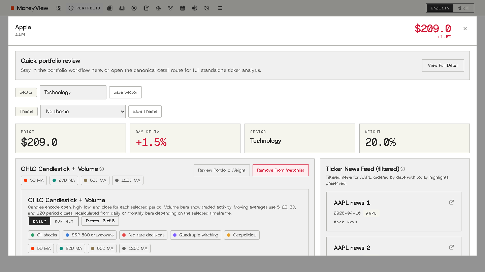
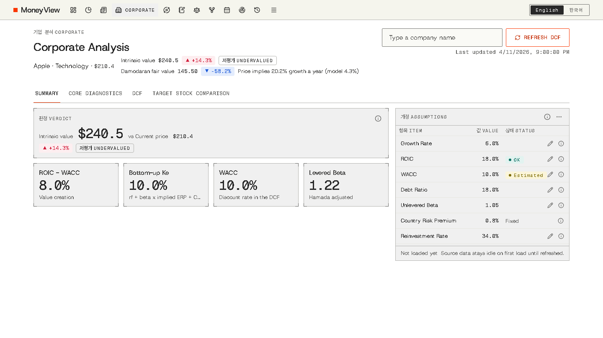
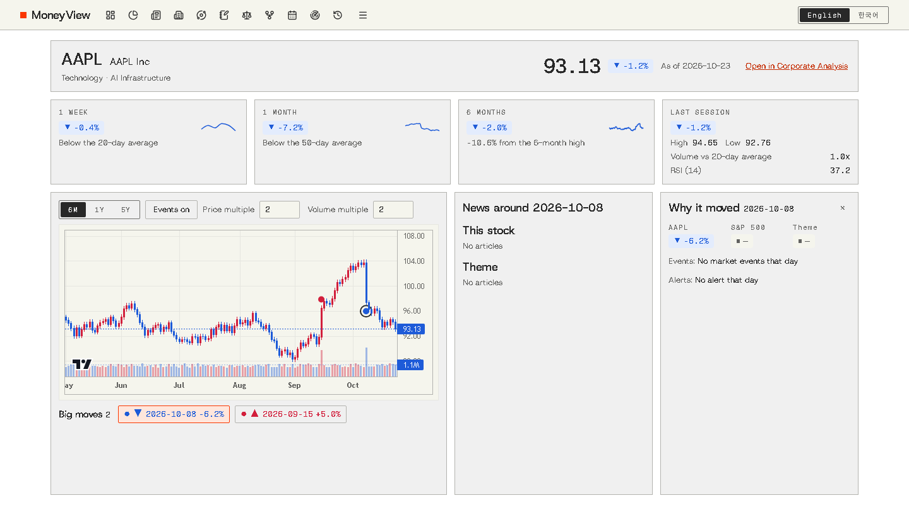
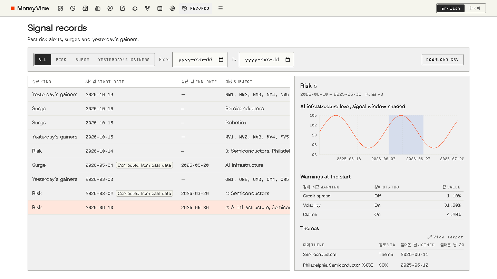
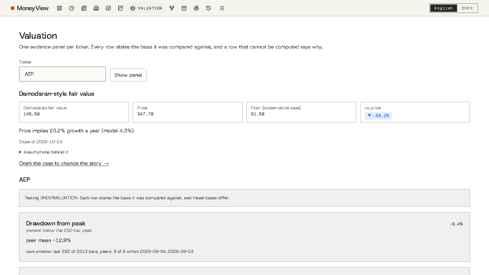
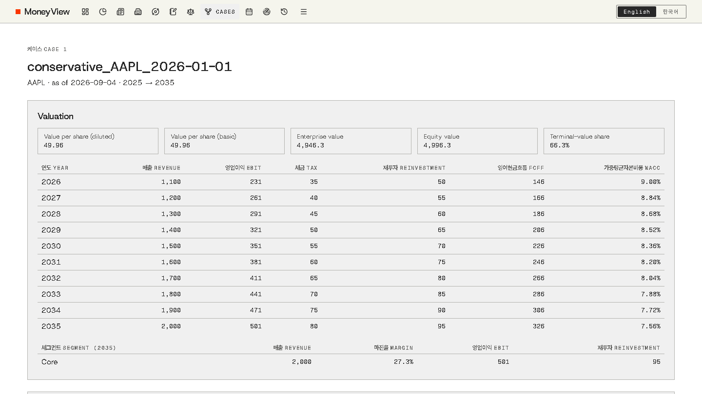
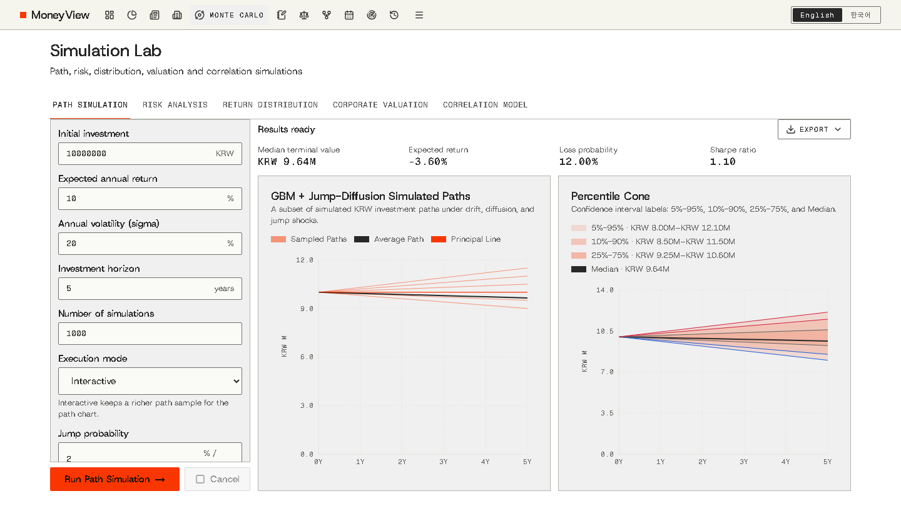

# MoneyView

<p align="center">
  
</p>

<p align="center">
  <strong>Local-first financial analytics workspace</strong><br/>
  Market monitoring, risk signals, portfolio attribution, DCF and Damodaran-style valuation, and Monte Carlo simulation in one dashboard.
</p>

---

## Contents

[User Guide](./docs/USER-GUIDE.md) · [What it is](#what-it-is) · [Requirements](#requirements) · [First-time setup](#first-time-setup) · [Running](#running) · [Screens](#screens) · [Developer dashboards](#developer-dashboards) · [Watchlist](#watchlist) · [Two PCs](#using-two-pcs) · [Testing](#testing) · [Shared types](#shared-schema-types) · [API](#key-api-endpoints) · [Layout](#repository-layout)

---

## What it is

A FastAPI backend ([`apps/api`](./apps/api)), a Next.js frontend ([`apps/web`](./apps/web)), and a shared finance engine ([`packages/core_finance`](./packages)), over local SQLite-backed workflows. Everything runs on your machine.

| Area | What it covers | Deep dive |
|---|---|---|
| **Market Overview** | 14 instruments (indices, sectors, rates, commodities, FX, crypto) with 1-day and 1-month moves, the risk-signal strip and panel | [`docs/tabs/market-overview-tab.txt`](./docs/tabs/market-overview-tab.txt) |
| **Portfolio** | Holdings, saved snapshots, benchmark comparison, attribution, a per-stock modal with chart, metrics and news | [`docs/tabs/portfolio-tab.txt`](./docs/tabs/portfolio-tab.txt) |
| **Corporate Analysis** | DCF assumptions and verdict, the Damodaran-style fair value beside it, hurdle-rate decomposition, sensitivity | [`docs/tabs/corporate-analysis-tab.txt`](./docs/tabs/corporate-analysis-tab.txt) |
| **Stock detail** | One screen per ticker: trend tiles, adjustable big-move marks with a "why it moved" card, dated news, yesterday's movers | [spec](./docs/superpowers/specs/2026-10-25-stock-detail-screen-design.md) |
| **Signal records** | Past risk alerts, surges and yesterday's gainers, each with a report | [spec](./docs/superpowers/specs/2026-10-20-risk-ui-design.md) |
| **Valuation & Cases** | A Damodaran-style fair value for any stock, the growth today's price implies, segment build-up cases you can fork and simulate | [`docs/tabs/cases-tab.txt`](./docs/tabs/cases-tab.txt) |
| **Simulation Lab** | Path simulation, risk analysis, return distribution, corporate valuation, correlation model | [`docs/tabs/monte-carlo-tab.txt`](./docs/tabs/monte-carlo-tab.txt) |

Start at [`docs/INDEX.md`](./docs/INDEX.md) for a map of every document in the repo.

## Stack

| Layer | Tools |
|---|---|
| Frontend | Next.js, React, TypeScript, Recharts, lightweight-charts |
| Backend | FastAPI, Pydantic |
| Data | SQLite, local cache, Yahoo/yfinance-based ingestion paths |
| Python tooling | Conda, `uv`, `pytest` |
| Frontend tooling | Node.js, `npm`, Playwright |

## Requirements

Conda · Python `>=3.12` · Node.js `>=20` · `uv` · `npm`

## First-time setup

Do this once, before the first run.

```powershell
conda create -n moneyview python=3.13 -y
conda activate moneyview
python -m pip install -U uv
uv pip install -e ".[dev]"
cd apps\web; npm install; cd ..\..
Copy-Item config\.env.example config\.env
```

Then install the global `run` command, so you can start MoneyView from any folder:

```powershell
powershell.exe -ExecutionPolicy Bypass -File scripts\install_run_command.ps1
```

> If you skip the dependency steps, the launcher installs what is missing on first run —
> or force it with `run MoneyView -InstallDeps`. Backend packages install into the selected
> runtime env; if your active env is `base` and a `moneyview` env exists, `moneyview` wins.

## Running

```cmd
run MoneyView
```

That is the whole thing. It starts the backend and frontend, opens a PowerShell window for
each, and opens your browser.

**No command line?** Double-click `Install MoneyView Shortcuts.cmd` once. It puts **MoneyView**
and **Stop MoneyView** shortcuts on the Desktop and in the Start menu; after that, starting and
stopping is a double-click. How to use each screen, read the numbers and fix common problems:
the [User Guide](./docs/USER-GUIDE.md).

**Didn't install the global command?** Run the same thing from the repo root — `.\run.cmd MoneyView`
in PowerShell, or `run MoneyView` in `cmd.exe`. Both forward to the canonical launcher,
[`scripts/start_local.ps1`](./scripts/start_local.ps1), which you can also call directly:

```powershell
powershell.exe -ExecutionPolicy Bypass -File scripts\start_local.ps1 -OpenBrowser
```

### Where things are

| | |
|---|---|
| App | http://localhost:3000 |
| Portfolio · Corporate · Monte Carlo | `/portfolio` · `/corporate` · `/monte-carlo` |
| API health | http://127.0.0.1:8000/api/v1/health |
| API docs | http://127.0.0.1:8000/docs |
| Logs | `data/cache/logs/api-server.log`, `data/cache/logs/next-server.log` |

**To stop:** close the two spawned PowerShell windows.

### Launcher options

| Flag | Effect |
|---|---|
| `-CheckOnly` | Validate prerequisites and ports, start nothing |
| `-AutoPort` | Scan for free ports when 8000/3000 are taken |
| `-InstallDeps` | Install missing backend/frontend dependencies first |
| `-DevMonitor` | Enable server-side performance instrumentation (see below) |
| `-BuildWeb -ProductionWeb` | Production build instead of `next dev` — much lighter |

The Desktop/Start-menu shortcuts wrap this launcher; how they are built and how Stop
MoneyView picks what to stop: [docs/desktop-shortcuts.md](./docs/desktop-shortcuts.md).

### Running the halves separately

```powershell
python -m uvicorn apps.api.main:app --host 127.0.0.1 --port 8000 --reload
```

```powershell
cd apps\web; npm run dev
```

> If PowerShell blocks `npm`, use `npm.cmd run dev`.

### Resource cost

`run MoneyView` uses roughly **1.5–1.7 GB of RAM** — about 85% of that is `next dev`, with the
FastAPI backend at ~156 MB. CPU is bursty during route compilation, then idle. If you are
*using* MoneyView rather than developing the frontend, `-BuildWeb -ProductionWeb` is
substantially lighter.

[`docs/local-run-resources.md`](./docs/local-run-resources.md) has the measured figures, the
measurement method, and the operational hazards — notably that a `next dev` which logs "Ready"
but never binds its port does not exit, and has reached 5 GB.

## Screens

Captured from fixture data with `README_CAPTURE=1 npx playwright test tests/e2e/readme-capture.spec.ts`
(in `apps/web`), so they show sample tickers rather than anyone's watchlist.

<details>
<summary><strong>Market Overview</strong> — 14 instruments, 1-day and 1-month moves, the risk-signal strip</summary>
<p align="center"></p>
</details>

<details>
<summary><strong>Portfolio</strong> — holdings, snapshot summary, per-stock modal</summary>
<table>
  <tr>
    <td width="33%"></td>
    <td width="33%"></td>
    <td width="33%"></td>
  </tr>
</table>
</details>

<details>
<summary><strong>Corporate Analysis</strong> — DCF intrinsic value and the Damodaran-style fair value, side by side</summary>
<p align="center"></p>
</details>

<details>
<summary><strong>Stock detail</strong> — trend tiles, big-move marks and the "why it moved" card</summary>
<p align="center"></p>
</details>

<details>
<summary><strong>Signal records</strong> — past risk alerts, surges and gainers with their reports</summary>
<p align="center"></p>
</details>

<details>
<summary><strong>Valuation and cases</strong> — fair value, the growth the price implies, a segment build-up case</summary>
<table>
  <tr>
    <td width="50%"></td>
    <td width="50%"></td>
  </tr>
</table>
</details>

<details>
<summary><strong>Simulation Lab</strong> — path simulation, risk, distributions, valuation uncertainty, correlation</summary>
<p align="center"></p>
</details>

## Developer dashboards

Two dashboards exist and are **not linked from any navigation**:

| URL | What |
|---|---|
| `http://localhost:3000/dev/performance` | Request waterfalls, scope breakdown, per-ticker cost, cache effectiveness |
| `http://localhost:3000/dev/monitor` | Live event tail and latency panels |

Both need server-side instrumentation, which is **off by default** — it costs 12–19% request
latency and up to 128 MB. Turn it on for a run:

```cmd
run MoneyView -DevMonitor
```

The startup banner then prints the dashboard URLs. Without the switch it says the dashboards
are disabled and names the flag, rather than leaving you at a blank page.

## Watchlist

Portfolio holdings live in the local SQLite `watchlist` table, and **that table is the source
of truth**. On first run:

- rows already in the DB are used as-is
- if empty and `apps/api/services/webscrap/stock_targets.json` exists, MoneyView seeds from it once
- if empty and that file is missing, MoneyView seeds a small built-in default once

Once you add or delete holdings from the Portfolio page, those changes are authoritative —
bootstrap seeding will not overwrite them.

The Portfolio page uses saved positive weights when they exist, and falls back to an
equal-weight basket when none do. If saved weights total under `100%`, the remainder is
treated as implied cash in the attribution flow.

## Using two PCs

Code travels through GitHub; data does not. Each PC keeps its own SQLite database
(`data/processed/moneyview.db`, git-ignored), so a change made in one PC's database —
adding or removing a holding, deleting caches — has to be repeated on the other unless
sync is on (below).

**Bring the other PC up to date**

1. Close MoneyView on that PC.
2. Pull the code:

   ```powershell
   cd C:\Learn\Economy\MoneyView
   git fetch origin
   git checkout renewal
   git pull origin renewal
   ```

3. Start MoneyView (`run MoneyView`). Database schema changes are applied on start; nothing
   needs to be run by hand. The first start after a long gap catches up on daily bars, the
   market indices and news, so the first few minutes are slower.
4. Make the watchlist match the first PC: add and remove the same holdings on the Portfolio
   page. Then attach themes, checking the dry run first:

   ```powershell
   python scripts/apply_watchlist_themes.py --dry-run
   python scripts/apply_watchlist_themes.py
   ```

5. Check that **Signal records** (the clock icon at the right end of the top bar) lists records,
   and that a stock's detail page shows a current S&P 500 figure rather than "—".

**When a ticker is renamed** (the company changed its symbol), remove the old ticker and add the
new one on each PC. The theme draft
(`docs/superpowers/specs/2026-10-18-risk-signal-evidence/themes-draft.csv`) and the news search
terms (`apps/api/services/risk/news_queries.yaml`) are in git, so change the ticker there once and
both PCs pick it up on their next pull.

**Caches of removed holdings** are deleted automatically 30 days after the holding is removed.
To delete them now, back up the database and run, with your own tickers:

```powershell
python -c "from apps.api.services.watchlist_cleanup import delete_ticker_caches as d; [print(t, d(t)) for t in ('TICKER1','TICKER2')]"
```

The function skips any ticker that is still referenced: on the watchlist or the corporate list,
in a valuation case, decision or comparison snapshot, a stored index, or a benchmark or spread
proxy in code.

**Sync between PCs.** Set the same folder (for example a OneDrive folder) in `config/.env` on both
PCs:

```text
MONEYVIEW_SYNC_DIR=C:\Users\<you>\OneDrive\MoneyView-sync
```

With it set, the watchlist and the records (cases, decisions, events, settings) are exchanged
through that folder. Turn it on only after both watchlists match: otherwise the newer row from one
PC overwrites the other's. Tests never read `config/.env`, so a test run cannot publish into this
folder.

## Testing

| Command | What it does |
|---|---|
| `pytest -q` | Python test suite |
| `cd apps\web; npm run test:e2e` | Playwright end-to-end suite (uses ports 3101/8110, not 3000/8000) |
| `cd apps\web; npx tsc --noEmit` | Frontend typecheck |
| `python scripts/validate_sqlite_schema.py` | Validate the local SQLite schema (add `--strict` to tighten) |
| `python scripts/ingest_dry_run.py` | Dry-run the ingestion sources |
| `python scripts/reconstruct_sqlite_db.py` | Preview a local DB reconstruction (add `--apply` to perform it, with backup) |
| `python scripts/benchmark_sqlite.py` | Benchmark SQLite workloads |
| `python scripts/benchmark_finance.py` | Benchmark finance workloads |

> The Playwright config sets `reuseExistingServer: false`, so two suite runs at once will kill
> each other's servers. Check 3101 and 8110 are free before starting one.

## Shared schema types

Backend Pydantic models are the source of truth for the public portfolio/report contracts.
Regenerate after changing a public model:

```powershell
python scripts/export_schema.py
npx json2ts packages/shared-types/generated/portfolio.schema.json > packages/shared-types/generated/portfolio.ts
```

Output lands in [`packages/shared-types/generated/portfolio.ts`](./packages/shared-types/generated/portfolio.ts).
Check for drift with `git diff --exit-code packages/shared-types`.

See [`docs/architecture/schema-evolution.md`](./docs/architecture/schema-evolution.md).

## Key API endpoints

Full reference: [`docs/api-usage.md`](./docs/api-usage.md). Interactive docs at `/docs` while running.

| Method | Path |
|---|---|
| `POST` | `/api/v1/portfolio/attribution` |
| `POST` | `/api/v1/report/summary` |
| `GET` `POST` | `/api/v1/portfolio/watchlist` |
| `DELETE` | `/api/v1/portfolio/watchlist/{ticker}` |

<details>
<summary>Example request bodies</summary>

`POST /api/v1/portfolio/attribution`

```json
{
  "tickers": ["AAPL", "MSFT", "TSLA"],
  "weights": [0.3333, 0.3333, 0.3333],
  "benchmark": "^GSPC",
  "period": "5y",
  "currency": "USD",
  "attribution_method": "brinson_fachler_arithmetic",
  "allow_synthetic_fallback": true,
  "allow_benchmark_proxy": true
}
```

`POST /api/v1/portfolio/watchlist`

```json
{
  "ticker": "AAPL",
  "name": "Apple Inc.",
  "sector": "Information Technology",
  "group_name": "core",
  "weight": 0.0
}
```

</details>

## Repository layout

```text
MoneyView/
├─ apps/
│  ├─ api/          FastAPI backend
│  └─ web/          Next.js frontend
├─ packages/        Shared finance engine and generated types
├─ config/          Local env files
├─ data/            SQLite cache, logs, images, raw and processed data
├─ docs/            Architecture, design, and per-tab documentation
├─ guideline/       SOPs and process specifications
├─ scripts/         Launcher, benchmarks, schema and ingestion tools
└─ tests/           Python test suite
```

## Notes

- Designed for local development and experimentation first.
- Screenshots load from [`data/img`](./data/img).
- PowerShell execution-policy warnings appearing *after* a command completes are usually
  non-blocking, unless the command itself failed.
