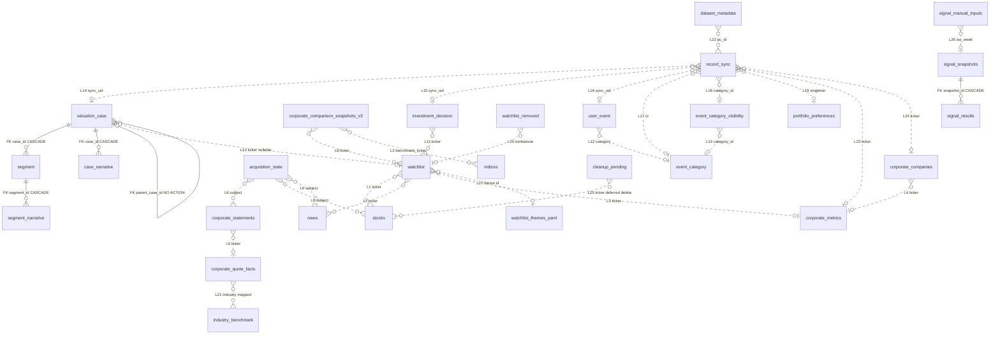
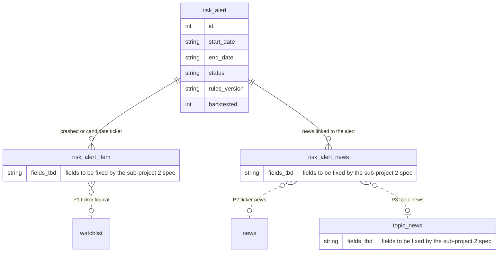
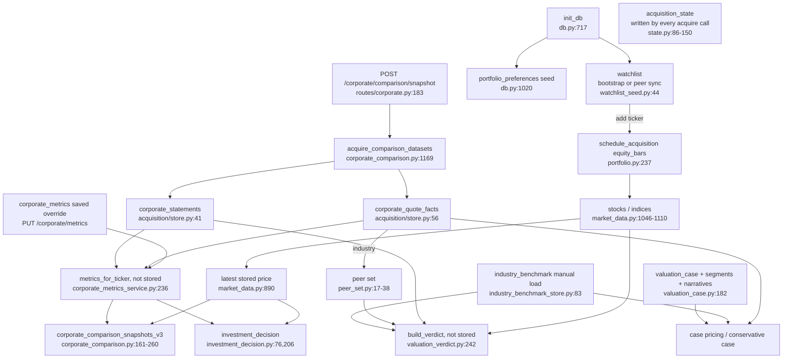

# MoneyView Database Relationships

## 1. Purpose And Scope

This document is a reference map of every table in MoneyView's SQLite database: what each table is,
which tables point at which, and in what order they must be populated. It complements, and does not
repeat, the prose in [`storage-model.md`](storage-model.md) (ownership and file artifacts),
[`schema-evolution.md`](schema-evolution.md) (Pydantic/TypeScript contract rules, not SQL),
[`data-flow.md`](data-flow.md) (end-to-end workflows) and
[`cache-ownership-invalidation.md`](cache-ownership-invalidation.md) (frontend/read-model caches).
Start at [`../INDEX.md`](../INDEX.md) for the full documentation map.

Last verified: 2026-10-18 against `apps/api/services/db.py` at 693adea (watchlist theme column) on branch
`feat/risk-signal`: 31 tables, 5 declared foreign keys, 27 logical references. Risk signal sub-project 1
(watchlist themes) is built; sub-projects 2-4 are only planned (§3.3).

Sources of truth used here:

- Schema: `_CREATE_SCHEMA_SQL` (which ends with `_SIGNAL_SCHEMA_SQL`) and `_ensure_schema_compatibility()`
  in `apps/api/services/db.py`. No
  other module in `apps/`, `packages/` or `scripts/` issues `CREATE TABLE` (verified by grep; see §7).
- Live schema cross-check: `data/processed/moneyview.db`, read through `sqlite_master` and `PRAGMA`
  only (no row data). The path default is `db.py:30`.
- There is **no** schema version number. `PRAGMA user_version` is 0 in the live DB and is never set in
  code. Migration is "create if absent, then add missing columns" (`db.py:717-733`, `db.py:736-1068`).
- Connections apply `PRAGMA foreign_keys=ON` (`db.py:190`), but only through `get_db()`/`init_db()`;
  SQLite defaults to OFF for any other connection.
- Dev-monitor has **no tables**: it writes JSONL files under `data/cache/logs/performance`
  (`apps/api/core/dev_monitor.py:22`). The macro signal engine (PR #67) has four tables (§2.10).

## 2. Table Inventory

31 tables (plus SQLite's internal `sqlite_sequence`). Line numbers are `CREATE TABLE` lines in
`apps/api/services/db.py` unless stated.

Class legend: **record** = user-authored record; **derived** = computed from other tables;
**cache** = upstream cache; **book** = bookkeeping.
Sync legend: **watchlist-sync** = watchlist peer sync (`apps/api/services/watchlist_sync/`);
**records-sync** = records peer sync (`apps/api/services/records_sync/kinds.py:108-193`);
**optional child** = rides inside its parent's payload with `optional=True`; both syncs are active only
when `MONEYVIEW_SYNC_DIR` is set (`records_sync/service.py:28-34`).

### 2.1 Portfolio / Watchlist (3)

| Table | Purpose | PK / unique keys | Class | Rebuildable? | Synced? | Owning module |
| --- | --- | --- | --- | --- | --- | --- |
| `watchlist` (:333) | Holdings, group, saved weight, optional theme id (`theme`, `''` = none; ids from `apps/api/services/watchlist_themes.yaml`, L27) | `id` PK; `ticker` UNIQUE | record | no (seed JSON only gives starter tickers) | yes, watchlist-sync (`updated_at`/`updated_by` merge key; `theme` rides as an optional field, a peer file without it reads as `''`, `peer_sync/model.py:77-85`, `watchlist_sync/files.py:86-95`) | `routes/portfolio.py`, `services/watchlist_seed.py`, `services/watchlist_sync/store.py` |
| `watchlist_removed` (:346) | Tombstone so an older peer copy cannot revive a removal | `ticker` PK | book | no | yes, watchlist-sync (tombstones travel with the file) | `services/watchlist_sync/store.py:100,124` |
| `portfolio_preferences` (:387) | Singleton: total investment, fee rate | `singleton_id` PK, `CHECK (singleton_id = 1)` | record | no | yes, records-sync (`singleton_uid`, `kinds.py:160-169`) | `routes/portfolio.py:137-152`; seeded `db.py:1020` |

`watchlist.theme` holds a stable theme id (`''` = none) from `apps/api/services/watchlist_themes.yaml`;
the list is read through `GET /portfolio/watchlist/themes`. The column is written only by
`POST /portfolio/watchlist/{ticker}/theme` (`routes/portfolio.py:290`, which rejects ids not in the
file and unknown tickers). The full-row upsert and the group route keep the stored value
(`routes/portfolio.py:180,244`), the destructive JSON resync snapshots it before the DELETE and writes it
back (`watchlist_seed.py:153-158`), and watchlist peer sync carries it as an optional field with no format
version bump (`peer_sync/model.py:77-85`, `watchlist_sync/files.py:86-95`, `watchlist_sync/store.py:75-104`).
The migration is `db.py:1005-1006`. An id missing from the yaml is kept in the DB, not erased (spec §1.1).

### 2.2 Market / News (4)

| Table | Purpose | PK / unique keys | Class | Rebuildable? | Synced? | Owning module |
| --- | --- | --- | --- | --- | --- | --- |
| `indices` (:261) | Index OHLCV bars | `id` PK; UNIQUE `(ticker, date)` | cache | yes, Yahoo via yfinance | no (`storage-model.md` §10 excludes) | `services/market_data.py:1073,1091` |
| `stocks` (:277) | Equity OHLCV bars | `id` PK; UNIQUE `(ticker, date)` | cache | yes, Yahoo | no | `services/market_data.py:1098` |
| `indicators` (:296) | Macro series | `id` PK; UNIQUE `(code, date)` | cache | unknown: no runtime writer exists (see Gap G3) | no | reader only: `services/news_service.py:89` |
| `news` (:316) | Headlines per ticker | `id` PK; `hash` UNIQUE (`news_identity_hash(ticker, url)`) | cache | partly: providers return only recent items | no | `services/news_service.py:183`, `services/acquisition/store.py:90` |

### 2.3 Acquisition / Upstream Cache (4)

| Table | Purpose | PK / unique keys | Class | Rebuildable? | Synced? | Owning module |
| --- | --- | --- | --- | --- | --- | --- |
| `acquisition_state` (:496) | Freshness and coverage per `(data_class, subject)` | PK `(data_class, subject)` | book | yes (a missing row just means "never acquired") | no | `services/acquisition/state.py:86-150` |
| `corporate_statements` (:511) | One row per ticker/statement/frequency/period/line item | PK `(ticker, statement_type, frequency, period_end, line_item)` | cache | yes, Yahoo | no | `services/acquisition/store.py:41` |
| `corporate_quote_facts` (:529) | Market cap, shares, beta, sector, industry, instrument type | `ticker` PK | cache | yes, Yahoo | no | `services/acquisition/store.py:56` |
| `industry_benchmark` (:646) | Damodaran industry averages per publication vintage | PK `(vintage, industry_name)` | cache | yes, from Damodaran's workbook, but loaded by hand (`industry_benchmark_store.py:9`) | no | `services/industry_benchmark_store.py:83-98` |

### 2.4 Corporate / Metrics / Comparison (5)

| Table | Purpose | PK / unique keys | Class | Rebuildable? | Synced? | Owning module |
| --- | --- | --- | --- | --- | --- | --- |
| `corporate_metrics` (:362) | Saved metric overrides per ticker | `ticker` PK | record | no | yes, records-sync (`uid_column=ticker`, never deleted; `kinds.py:175-184`) | `services/corporate_metrics_service.py:373,452` |
| `corporate_companies` (:379) | Manually added companies | `ticker` PK | record | no | yes, records-sync (`uid_column=ticker`, never deleted; `kinds.py:186-192`) | `services/corporate_metrics_service.py:366` |
| `corporate_comparison_snapshots` (:394, v1) | Legacy snapshots | PK `(snapshot_date, ticker)` | derived (dead) | no (inputs have moved) | no | none after migration (Gap G4) |
| `corporate_comparison_snapshots_v2` (:421) | Legacy snapshots | see `db.py:421-448` | derived (dead) | no | no | read once by migration `db.py:950-986` |
| `corporate_comparison_snapshots_v3` (:452) | Live snapshot history, one row per version and ticker | PK `(snapshot_version, ticker)` | derived | not reproducibly: `scripts/reset_snapshots.py:7-8` says rows "cannot be regenerated, because their inputs have moved" | no (`storage-model.md` §10) | `services/corporate_comparison.py:202,252,258,845` |

### 2.5 DCF / Valuation / Cases (4)

| Table | Purpose | PK / unique keys | Class | Rebuildable? | Synced? | Owning module |
| --- | --- | --- | --- | --- | --- | --- |
| `valuation_case` (:551) | Hand-authored segment build-up case | `id` PK; `case_name` UNIQUE; `sync_uid` UNIQUE index (`db.py:1017-1018`) | record | no | yes, records-sync (`natural_key=case_name`, lineage via `parent_case_id`) | `services/valuation_case.py:199` |
| `segment` (:605) | Revenue segment of a case | `id` PK; UNIQUE `(case_id, name)` | record | no | yes, as child of `valuation_case` | `services/valuation_case.py:222` |
| `segment_narrative` (:624) | Claim behind a segment input | PK `(segment_id, input_field)` | record | no | yes, child of `segment` | `services/valuation_case.py:234` |
| `case_narrative` (:636) | Claim behind a case-level input | PK `(case_id, input_field)` | record | no | yes, optional child (`kinds.py:83-92`) | `services/valuation_case.py:255` |

### 2.6 Decisions / Events (4)

| Table | Purpose | PK / unique keys | Class | Rebuildable? | Synced? | Owning module |
| --- | --- | --- | --- | --- | --- | --- |
| `investment_decision` (:576) | Buy/sell/watch/pass memo with copied figures | `id` PK; `sync_uid` UNIQUE index | record | no, and deliberately without retention (`db.py:603`) | yes, records-sync | `services/investment_decision.py:206` |
| `user_event` (:671) | User's chart events | `id` PK AUTOINCREMENT; `sync_uid` UNIQUE index | record | no | yes, records-sync | `services/events/store.py:58-83` |
| `event_category` (:683) | Built-in override or user category | `id` TEXT PK | record | no | yes, records-sync | `services/events/store.py:102-131` |
| `event_category_visibility` (:691) | Global chart filter per category | `category_id` PK | record | no | yes, records-sync | `services/events/store.py:96,143` |

Built-in events and categories are not in SQLite: they are read from committed JSON in
`apps/api/services/events/` (`categories.json`, `fomc.json`, `geopolitical.json`, `rules.json`).

### 2.7 Sync Bookkeeping (2, plus `watchlist_removed` above)

| Table | Purpose | PK / unique keys | Class | Rebuildable? | Synced? | Owning module |
| --- | --- | --- | --- | --- | --- | --- |
| `record_sync` (:698) | Per-record causal stamp and tombstone for every records-sync kind | PK `(kind, uid)` | book | stamps no (a lost tombstone can revive a deletion); `ensure_first_sync` re-baselines live records only | local table; its stamps and tombstones are published in this PC's peer file | `services/records_sync/store.py:96,261,273` |
| `dataset_metadata` (:356) | Key/value: watchlist state markers, `pc_id`, sync-enabled marker | `dataset_name` PK | book | yes, except the `pc_id` row, which is generated once per data directory (`watchlist_sync/store.py:18-31`) | no | `services/watchlist_seed.py:12-13,337,349`; `services/watchlist_sync/store.py:11-12` |

### 2.8 Other Domains

Dev-monitor: none (JSONL files). Market events reference `indices` read-only
(`services/events/price_events.py:160`). Signals: §2.10.

### 2.9 Cleanup Bookkeeping (1)

| Table | Purpose | PK / unique keys | Class | Rebuildable? | Synced? | Owning module |
| --- | --- | --- | --- | --- | --- | --- |
| `cleanup_pending` (:710) | A ticker that left the watchlist, and when; its cached rows are deleted `CLEANUP_GRACE_DAYS` (30) later if nothing refers to it | `ticker` PK | book | yes (a missing row is recorded as "now" by the next run) | no (each PC cleans on its own) | `services/watchlist_cleanup.py` (`record_pending` :82, `clear_pending` :92, `run_cleanup` :149) |

Details: [`watchlist-cleanup-and-corporate-sync.md`](watchlist-cleanup-and-corporate-sync.md).

### 2.10 Macro Signals (4)

| Table | Purpose | PK / unique keys | Class | Rebuildable? | Synced? | Owning module |
| --- | --- | --- | --- | --- | --- | --- |
| `signal_snapshots` (:217) | One weekly run: scenario probabilities and the `rules_version` used | `id` PK; `iso_week` UNIQUE (a re-run overwrites the week) | derived | not exactly: a re-run uses today's FRED data and rules | no | `services/signals/store.py:58` (`save_snapshot`), called by `engine.py:104` |
| `signal_results` (:226) | Each rule's verdict in a snapshot, with its contribution as computed at run time | PK `(snapshot_id, rule_id)` | derived | same as its snapshot | no | `services/signals/store.py:71-73` (replaced with its snapshot) |
| `signal_manual_inputs` (:239) | The user's verdict for a manual rule in one week | PK `(rule_id, iso_week)` | record | no | no | `PUT /signals/manual/{rule_id}` (`routes/signals.py:64,70`); `store.py:125` |
| `fred_cache` (:247) | FRED observations per series and date | PK `(series_id, obs_date)` | cache | yes, from FRED (needs `FRED_API_KEY`) | no | `services/signals/fetch.py:56`; `store.py:132` |

Rule definitions are not in SQLite: they are read from `apps/api/services/signals/rules.yaml`.

## 3. Relationships

### 3.1 Diagram

Solid lines are declared foreign keys. Dotted lines (`..`) are logical references with no database
constraint. Labels starting `L` match the IDs in the table below.

Not drawn because they are not references: `corporate_comparison_snapshots_v2 -> _v3` is a one-time
row copy (`db.py:950-986`); `investment_decision` copies figures out of the model at record time and
deliberately holds no reference to a snapshot (`db.py:584-589`). `corporate_comparison_snapshots_v3.snapshot_version`
is a derived string (L9 below), not a key into another table.

### 3.2 Reference Table

Declared foreign keys: **5**. Logical references: **27** (L1-L27).

| ID | From.column -> To.column | Kind | On delete | Enforced at |
| --- | --- | --- | --- | --- |
| F1 | `segment.case_id` -> `valuation_case.id` | declared FK | CASCADE | `db.py:607`; needs `foreign_keys=ON` (`db.py:190`) |
| F2 | `segment_narrative.segment_id` -> `segment.id` | declared FK | CASCADE | `db.py:625` |
| F3 | `case_narrative.case_id` -> `valuation_case.id` | declared FK | CASCADE | `db.py:637` |
| F4 | `valuation_case.parent_case_id` -> `valuation_case.id` | declared FK (self) | none (NO ACTION: deleting a parent that has forks is refused) | `db.py:572`; records-sync nulls it first at `records_sync/store.py:319-326` |
| F5 | `signal_results.snapshot_id` -> `signal_snapshots.id` | declared FK | CASCADE | `db.py:227`; `save_snapshot` also deletes a week's results before rewriting them (`signals/store.py:71`) |
| L1 | `stocks.ticker` -> `watchlist.ticker` | logical | none; bars survive a watchlist delete | not enforced; `portfolio.py:378` deletes only `watchlist` |
| L2 | `corporate_comparison_snapshots_v3.benchmark_ticker` -> `indices.ticker` | logical | none | normalised at `corporate_comparison.py:1110` |
| L3 | `corporate_metrics.ticker` -> `watchlist.ticker` / `corporate_companies.ticker` | logical | none | not enforced; `corporate_metrics_service.py:95-99` looks the sector up in both |
| L4 | `corporate_companies.ticker` -> `corporate_metrics.ticker` | logical (paired insert) | none | `add_company` writes both, `corporate_metrics_service.py:366-373` |
| L5 | `corporate_statements.ticker` -> `corporate_quote_facts.ticker` | logical | none | joined in app by `acquisition/store.py:137-150` |
| L6 | `acquisition_state.(data_class, subject)` -> store table named in `REGISTRY` | logical | none; retire only flips status, rows kept | `acquisition/registry.py:38-83`; `state.py:109-127` |
| L7 | `news.ticker` -> `watchlist.ticker` | logical | none | not enforced |
| L8 | `corporate_comparison_snapshots_v3.ticker` -> `watchlist` / `corporate_companies` / `indices` | logical | none; snapshot rows outlive the ticker (365 days) | built at `corporate_comparison.py:947-1016` |
| L9 | `snapshot_version` string -> `snapshot_date`, `universe_key`, rf, erp, schema columns | logical (derived key) | none | `corporate_comparison.py:1136-1166` |
| L10 | `valuation_case.ticker` -> ticker universe (NULL allowed) | logical | none | not enforced; private companies are first-class (`db.py:546-547`) |
| L11 | `investment_decision.ticker` -> ticker universe | logical | none | not enforced; NOT NULL only |
| L12 | `user_event.category` -> `event_category.id` or built-in id in `categories.json` | logical | app-enforced RESTRICT: category delete refused while events use it | create check `events/service.py:40`; delete check `events/service.py:138-140` |
| L13 | `event_category_visibility.category_id` -> `event_category.id` / built-in id | logical | app-enforced: deleted with its user category | `events/store.py:132` |
| L14 | `record_sync(kind='valuation_case', uid)` -> `valuation_case.sync_uid` | logical | tombstone row outlives the record by design | `records_sync/kinds.py:107-125`; `store.py:273` |
| L15 | `record_sync(kind='investment_decision', uid)` -> `investment_decision.sync_uid` | logical | same | `kinds.py:126-135` |
| L16 | `record_sync(kind='user_event', uid)` -> `user_event.sync_uid` | logical | same | `kinds.py:136-143`; `events/store.py:79-83` |
| L17 | `record_sync(kind='event_category', uid)` -> `event_category.id` | logical | same | `kinds.py:144-151` |
| L18 | `record_sync(kind='event_category_visibility', uid)` -> `.category_id` | logical | same | `kinds.py:152-159` |
| L19 | `record_sync(kind='portfolio_preferences', uid)` -> singleton row | logical | n/a (row is never deleted) | `kinds.py:160-169` |
| L20 | `watchlist_removed.ticker` -> `watchlist.ticker` | logical (tombstone) | tombstone beats an older row; a newer re-add wins | `watchlist_sync/store.py:100-124`; `peer_sync/model.py:1-9` |
| L21 | `corporate_quote_facts.industry` -> `industry_benchmark.industry_name` | logical via a Yahoo-to-Damodaran map | none | `industry_benchmark_store.py:134-141`; `industry_maps.py` |
| L22 | `dataset_metadata[watchlist_sync_pc_id].source` -> `watchlist.updated_by`, `record_sync.updated_by/removed_by` | logical (author id) | none | `watchlist_sync/store.py:18-31`; `records_sync/service.py:53` |
| L23 | `record_sync(kind='corporate_metrics', uid)` -> `corporate_metrics.ticker` | logical | no tombstones: the kind never deletes | `records_sync/kinds.py:175-184` |
| L24 | `record_sync(kind='corporate_companies', uid)` -> `corporate_companies.ticker` | logical | same | `records_sync/kinds.py:186-192` |
| L25 | `cleanup_pending.ticker` -> that ticker's rows in `stocks`, `news`, `corporate_quote_facts`, `acquisition_state` | logical (deferred deletion) | rows deleted 30 days after `removed_at` unless a reference names the ticker | `watchlist_cleanup.py:39` (`CLEANUP_TABLES`), `:149` |
| L26 | `signal_manual_inputs.iso_week` -> `signal_snapshots.iso_week`; `rule_id` -> a manual rule in `signals/rules.yaml` | logical | none; an input saved for a week with no snapshot applies at that week's next run | `signals/engine.py:89` |
| L27 | `watchlist.theme` -> `id` in `apps/api/services/watchlist_themes.yaml` | logical (file, not a table) | none; an id no longer in the file stays in the DB and displays as other | `routes/portfolio.py:290-320` validates on write; `watchlist_themes.py` `theme_ids`; peer sync does not validate |

### 3.3 Planned (risk signal sub-project 2, not built)

Nothing in this subsection exists in `db.py`. It restates spec `docs/superpowers/specs/2026-10-18-risk-signal-design.md`
(§2.1, §2.3a, §2.7) so the shape can be reviewed before the sub-project 2 spec fixes it. Table and column
names are **provisional**; every field list marked "fields to be fixed by the sub-project 2 spec" is
deliberately empty. Alerts are computed per PC and are not synced (spec R-B7). Dotted lines are
logical references, the same convention as §3.1.

- `risk_alert`: one row per alert. Spec §2.1 lists id, start date, status (active or cleared), the
  indicators that triggered it with their values, the crashed and candidate tickers, and the linked news.
  `end_date` is NULL while active. `rules_version` records which threshold-file version produced it
  (§2.3a). `backtested` marks alerts computed from 2016-2026 history, as opposed to alerts the app raised
  live. Where the triggering indicator values are stored (a column, or a child table) is open.
- `risk_alert_item`: one row per crashed or candidate ticker of an alert. It must tell the two decks apart,
  so it carries a kind; the rest, including the 5, 10 and 20 trading-day outcomes the spec wants kept
  (§2.3a), is fields to be fixed by the sub-project 2 spec. `ticker` refers to `watchlist.ticker` logically,
  like every other ticker link (§3.2); the spec's history must survive a later watchlist removal, so no FK.
- `risk_alert_news`: links an alert to its 10 or more news items, macro first and then industry (§2.7).
- `topic_news`: macro topic news (CPI, PCE, FOMC, jobs, yields, credit, oil) in English and Korean. The
  existing `news` table is keyed by ticker and holds only English Google News RSS today, so whether topic
  items get their own table or reuse `news` is not decided; the diagram assumes a separate table.
- Not tables: the threshold values live in a checked-in rules file (spec §2.6), and the new FRED series
  (`THREEFYTP10`, `CPIAUCSL`, `PCEPI`, `PCEPILFE`) go into the existing `fred_cache`.

## 4. Dependencies (Write / Refresh Order)

A table is only meaningful after its inputs exist. The metric layer never fetches: it reads what
acquisition stored, so a snapshot is reproducible (`market_data.py:890-897`,
`acquisition/store.py:137-170`).

Ordering rules and where they live:

1. **Schema and singleton first.** `init_db()` runs from the app lifespan and seeds
   `portfolio_preferences` (`db.py:1020`). Records sync runs once at startup (`main.py:113`).
2. **Watchlist before bars.** Adding a ticker schedules `equity_bars` acquisition on a daemon thread
   (`routes/portfolio.py:237`, `acquisition/runner.py:170-186`). Bars are also written by the lazy
   refresh inside `MarketDataService.get_stock_ohlcv` (`market_data.py:1212`, saves at `:1165`, `:1199`).
3. **Quote facts before peer sets.** `peer_set.resolve_peers` reads `corporate_quote_facts.industry`
   for the ticker and its peers (`peer_set.py:25-35`); an empty industry yields a refusal reason, not a
   guess (`peer_set.py:27`). Same dependency for the Damodaran row (`industry_benchmark_store.py:137`).
4. **Statements and quote facts before metrics.** `load_statement_bundle` returns `None` when no
   statement rows exist (`acquisition/store.py:150-151`); metrics then fall back to `corporate_metrics`
   or defaults (`corporate_metrics_service.py:171-213`). Metrics are not persisted.
5. **Metrics and a stored price before the comparison snapshot.** The snapshot job acquires
   statements and quote facts first (`routes/corporate.py:197-206`, `corporate_comparison.py:1169-1211`;
   freshness boundaries: statements weekly, market cap daily, `acquisition/registry.py:56-72`), then
   computes and writes `corporate_comparison_snapshots_v3` (`corporate_comparison.py:200-262`).
6. **Cases are independent of acquisition** (`db.py:546-547`), but pricing a case reads
   `corporate_quote_facts.industry` and `industry_benchmark` (`case_pricing.py:15`,
   `industry_benchmark_store.py:134-141`).
7. **Decisions copy figures at write time** from the model and refuse to store fabricated ones
   (`investment_decision.py:150-200`).

Writers by table:

| Table | Writers (job / endpoint) |
| --- | --- |
| `watchlist` | `POST /portfolio/watchlist` (`routes/portfolio.py:180`, keeps the stored theme), `POST /portfolio/watchlist/{ticker}/group` (`:244`), `POST /portfolio/watchlist/{ticker}/theme` (`:290`, the only route that writes `theme`), `DELETE /portfolio/watchlist/{ticker}` (`:378`); bootstrap/import `watchlist_seed.py:83,120,153-158` (resync snapshots `theme` before its DELETE and writes it back); peer sync `watchlist_sync/store.py:75-104` (carries `theme`) |
| `portfolio_preferences` | `PUT /portfolio/preferences` (`portfolio.py:137`); records-sync apply |
| `stocks`, `indices` | acquisition `equity_bars`/`index_bars` (`acquisition/runner.py:44-47`); lazy refresh in `market_data.py`; legacy `scripts/migrate_data.py`; e2e seed `scripts/seed_e2e_market_cache.py`; `stocks` (not `indices`) deleted by the watchlist cleanup |
| `news` | `POST /news/acquire`, `/news/crawl*` (`routes/news.py:67,77,145`); `news_service.save_article`; `scripts/rekey_news.py`; ticker rows deleted by the watchlist cleanup |
| `acquisition_state` | every `acquire`/`acquire_point_in_time`/`retire_subject` call; deleted by the watchlist cleanup, except `statements` |
| `corporate_statements`, `corporate_quote_facts` | `acquire_comparison_datasets` only (`corporate_comparison.py:1200-1211`); `corporate_quote_facts` (not `corporate_statements`) deleted by the watchlist cleanup |
| `industry_benchmark` | `store_vintage`, which has **no caller** in the repo (manual) |
| `corporate_metrics` / `corporate_companies` | `PUT /corporate/metrics/{ticker}` (`routes/corporate.py:526`); `POST /corporate/companies` (`routes/corporate.py:149`); records-sync apply |
| snapshots v3 | `POST /corporate/comparison/snapshot` (`routes/corporate.py:183`) (`storage-model.md` §5.3 also lists a `scheduled_kst_daily` source, but no code in `apps/api` sets that value; see Gap G11); delete `DELETE /corporate/comparison/snapshot-version` (`routes/corporate.py:261`) |
| `valuation_case` family | `POST /valuation/cases`, `/fork`, `/conservative/{ticker}` (`routes/valuation.py:42,110,203`); seed `valuation_seed.py:476-479` |
| `investment_decision` | `POST /decisions` (`routes/decisions.py:20`) |
| `user_event`, `event_category*` | `routes/market.py:96-149` through `events/store.py` |
| `record_sync` | `records_sync/store.py` (stamp, tombstone, apply) |
| `dataset_metadata` | `watchlist_seed.py:349,361`; `watchlist_sync/store.py:28,48` |
| `cleanup_pending` | `record_pending` from the watchlist delete (`routes/portfolio.py:392`), the import (`watchlist_seed.py:165`) and watchlist-sync apply (`watchlist_sync/store.py:81`); `clear_pending` from every add path; the cleanup run (startup and daily) |
| `signal_snapshots`, `signal_results` | `POST /signals/run` and the hourly catch-up `signal_cycle` through `signals/engine.py:104` |
| `signal_manual_inputs` | `PUT /signals/manual/{rule_id}` (`routes/signals.py:70`) |
| `fred_cache` | the signal run's FRED fetch (`signals/fetch.py:56`) |

## 5. Lifecycle Notes

**Deletion paths.**

- *Watchlist delete* removes only the `watchlist` row, writes a `watchlist_removed` tombstone when sync
  is on, then marks `acquisition_state` as retired (`routes/portfolio.py:378-399`,
  `acquisition/state.py:109-127`), and records the ticker in `cleanup_pending`. 30 days later, if no
  reference names it, the cleanup deletes its rows in `stocks`, `news`, `corporate_quote_facts` and
  `acquisition_state` (L25). `corporate_statements`, `corporate_metrics`, `corporate_companies` and
  snapshot rows stay. Re-adding the ticker inside the 30 days clears the pending row.
- *Snapshot delete* (`corporate_comparison.py:836-848`) deletes every row of one `snapshot_version`
  and nothing else. Automatic pruning deletes rows with `snapshot_date` older than 365 days (KST) and
  rows of the current version whose ticker left the universe (`corporate_comparison.py:251-260`).
- *Valuation case*: no API deletes a case. The only delete is the records-sync apply, which deletes by
  `sync_uid` after nulling local forks' `parent_case_id` (`records_sync/store.py:64`, `:319-326`) and
  clears children explicitly before rewrite (`:328-332`); grandchildren rely on F2's CASCADE.
- *Decision*: no delete path at all locally (`routes/decisions.py` has POST and GET only).
- *User category delete*: refused while events use it (L12); also removes its visibility row
  (`events/store.py:131-141`) and writes tombstones for both kinds.
- *Destructive watchlist import* (`watchlist_seed.py:147`) clears `watchlist` entirely; refused while
  peer sync is on (`storage-model.md` §4.4).

**Uniqueness and idempotency keys used for upserts.**

| Table | Key | Statement |
| --- | --- | --- |
| `stocks`, `indices` | `(ticker, date)` | `INSERT OR REPLACE` (`market_data.py:1073-1098`) |
| `news` | `hash` of `(ticker, url)` | `INSERT OR IGNORE` (`acquisition/store.py:90`) |
| `corporate_statements` | full 5-column PK | `INSERT OR REPLACE` (`acquisition/store.py:41`) |
| `corporate_quote_facts`, `corporate_metrics`, `corporate_companies` | `ticker` | `INSERT OR REPLACE` |
| `acquisition_state` | `(data_class, subject)` | `ON CONFLICT DO UPDATE`; coverage widens via `MIN`/`MAX` (`state.py:130-150`) |
| `industry_benchmark` | `(vintage, industry_name)` | `INSERT OR REPLACE` (`industry_benchmark_store.py:89`) |
| snapshots v3 | `snapshot_version` = `date\|universe_key\|rf=\|erp=\|schema=` (deterministic) | `INSERT OR REPLACE`, so repeated refreshes replace in place (`corporate_comparison.py:1136-1166`, `:202`) |
| `valuation_case` | `case_name` UNIQUE locally; `sync_uid` across PCs | insert, then `sync_uid` assigned (`valuation_case.py:199-217`) |
| `event_category` | `id` | `ON CONFLICT(id) DO UPDATE` (`events/store.py:101-107`) |
| `record_sync` | `(kind, uid)` | add and remove halves upserted independently (`records_sync/store.py:253-281`) |

The save-then-record sequence in `acquire_point_in_time` is two commits on purpose; a crash between
them self-heals because every saver is idempotent (`runner.py:146-155`).

**Timestamps and time zones (as the code states them).**

| Column(s) | Convention | Source |
| --- | --- | --- |
| `watchlist.updated_at`, `record_sync.*_at`, `watchlist_removed.removed_at` | UTC, `YYYY-MM-DDTHH:MM:SS.mmmZ`; `SEED_TS` year 0000 below `BASELINE_TS` 1970 | `db.py:340`; `peer_sync/model.py:17-22` |
| `snapshot_date` | KST business date (`Asia/Seoul`), cadence `daily_kst_0000`, retention 365 days | `corporate_comparison.py:42-44,931-940` |
| `snapshot_taken_at` | UTC ISO-8601 | `corporate_comparison.py:184` |
| acquisition freshness boundaries | UTC (daily at 00:00 UTC, weekly Monday 00:00 UTC, hourly) | `acquisition/registry.py:30-36,79` |
| `acquisition_state.last_*_at` | `now.isoformat()` of an aware UTC datetime | `state.py:99-105`; `runner.py:182` |
| `corporate_statements.fetched_at`, `corporate_quote_facts.fetched_at`, `corporate_metrics.updated_at`, `corporate_companies.updated_at`, `investment_decision.decided_at` | UTC ISO-8601 | `acquisition/store.py:38,62`; `corporate_metrics_service.py:363,471`; `investment_decision.py:213` |
| `user_event.created_at`, `event_category.created_at` | UTC via `strftime('%Y-%m-%dT%H:%M:%fZ','now')` | `db.py:677,688` |
| `portfolio_preferences.updated_at` | SQLite `CURRENT_TIMESTAMP`, UTC `YYYY-MM-DD HH:MM:SS`; `''` for the seeded default | `routes/portfolio.py:143`; `records_sync/store.py:70-75` |
| `industry_benchmark.vintage` | Publication date, not fetch date | `db.py:647`; `industry_benchmark_store.py:3-8` |
| `news.published_date` | Provider text, may be `''` | `db.py:322`; `acquisition/store.py:77-80` |

## 6. Gaps And Risks Found

Reported only; no code was changed.

- **G1 (resolved 2026-10-15, PR #68). Ticker links have no FK; deleting a watchlist row orphans everything else.** Only five FKs
  exist (§3.2). `routes/portfolio.py:378` deletes `watchlist` only, and retire keeps all rows
  (`runner.py:189-192`). `corporate_metrics` and snapshot rows for removed tickers therefore remain
  and can still appear in `corporate_comparison.py:947-1016`'s registry (it unions `watchlist`,
  `corporate_companies` and `indices`).
  *Resolution:* the deferred cleanup (§2.9, L25). *Correction:* the registry never kept a removed ticker;
  the leak was `list_companies`' loop over the seed file, now removed. `corporate_statements` is kept,
  not cleaned.
- **G2 (resolved 2026-10-15, PR #68). User-authored `corporate_metrics` and `corporate_companies` were local-only.** They are saved by
  hand (`routes/corporate.py:149,526`) but are not in `KINDS` (`records_sync/kinds.py:106-170`), so the
  second PC never receives them. No code path deletes either table's rows.
  *Resolution:* both are records-sync kinds now (L23, L24), never deleted.
- **G3. `indicators` has no runtime writer.** The only INSERT is the legacy CSV importer
  `scripts/migrate_data.py:127`. `webscrap/finance.py:66-105` builds `EconomicIndicator` lists but
  nothing persists them. The only reader is the first-run news fallback `news_service.py:89`.
  `storage-model.md` §3.1 still describes it as the macro series store. Whether macro persistence is
  intended to return with the signal engine is unknown. (The signal engine stores FRED series in its own
  `fred_cache`, §2.10, and does not write `indicators`.)
- **G4. Dead legacy snapshot tables.** `corporate_comparison_snapshots` (v1) is never read; `_v2` is read
  once, only when v3 is empty (`db.py:950-986`). Both still get indexes (`db.py:418,449`) and exist in
  the live DB. Only `scripts/reset_snapshots.py:25-29` touches them afterwards. v3 also carries
  `expected_return_spread`, kept "so history survives" but unread (`db.py:928-935` comment;
  `corporate_comparison.py:56-57`: "the old column is retired, not read").
- **G5. `industry_benchmark` is populated by a function nobody calls.** `store_vintage` has no caller
  (`industry_benchmark_store.py:83`). Conservative cases and verdicts depend on it
  (`case_pricing.py:15`, `valuation_verdict.py:21`) and degrade to a refusal when empty. Whether the
  live table has rows was not checked (row data was out of bounds).
- **G6. Valuation cases cannot be deleted from the app, and a parent case cannot be deleted while it
  has forks.** F4 has no `ON DELETE`. Only the sync path nulls `parent_case_id` first
  (`records_sync/store.py:319-326`). Cascades (F1-F3) only fire on connections that set
  `PRAGMA foreign_keys=ON`, which `get_db()` does (`db.py:190`) and a raw `sqlite3.connect` does not.
- **G7. Event category existence is not re-checked when a peer's record is applied.** The local create
  check is `events/service.py:40`; `KIND_USER_EVENT` has no domain or reference check
  (`kinds.py:136-143`). A user category deleted on one PC while another PC still has events using it
  could leave `user_event.category` pointing at nothing after a merge. This is inferred from the code
  and not reproduced by a test.
- **G8. `dataset_metadata` is an untyped key/value table carrying identity.** The generated `pc_id` is
  stored in the `source` column of the `watchlist_sync_pc_id` row (`watchlist_sync/store.py:18-31`) and
  is reused as author for records sync (`records_sync/service.py:53`). Losing that row changes the
  PC's identity for every future stamp.
- **G9. Snapshot history is not reproducible.** `scripts/reset_snapshots.py:7-8` states this, and the
  same script deleted 880 snapshot rows once without a backup (documented at
  `scripts/reset_snapshots.py:11-16`). No FK or trigger protects the table; the guard is script-level.
- **G11. Scheduled snapshots have no writer in code.** `storage-model.md` §5.3 lists
  `scheduled_kst_daily` as a snapshot source; the only value any caller passes is `manual_refresh`
  (`routes/corporate.py:209`), and a grep of `apps/` for `scheduled_kst_daily` finds nothing. Snapshots are therefore created on manual refresh (or the on-demand path described in
  `storage-model.md` §5.4, not re-verified here).
- **G10. Documentation gaps.** `storage-model.md` never mentions `acquisition_state`,
  `corporate_statements`, `corporate_quote_facts` or `industry_benchmark`.
- **G12. The watchlist cleanup does not count market-overview proxy tickers kept in `stocks`.**
  `_REFERENCE_QUERIES` (`services/watchlist_cleanup.py:59-71`) names `watchlist`, `corporate_companies`,
  `corporate_metrics`, `indices`, `valuation_case`, `investment_decision` and the snapshot tables, but not
  the proxies the market overview stores in `stocks` (BOTZ, SKYY, XLE, ITA, CIBR, ICLN, TSL, 143860.KS,
  ^KS11). Such a ticker is a cache candidate (`_CANDIDATE_QUERIES`, `:50`) with no reference, so it enters
  `cleanup_pending`, its `stocks`, `news`, `corporate_quote_facts` and `acquisition_state` rows are deleted
  after `CLEANUP_GRACE_DAYS` (30), and the next overview request refetches them. Open. The fix is planned
  in risk signal sub-project 2.

**Drift between live DB and code.** Comparing `data/processed/moneyview.db` with a database freshly built
by `init_db()` (via `DB_PATH` pointed at a scratch file):

- Re-checked 2026-10-18 from a schema-only dump of the live DB (no row data): 31 tables, matching the 31 in §2; columns and foreign keys match `db.py` (including `watchlist.theme`). Indexes were not re-compared in that pass; the 15-index figure below dates from the earlier 26-table check.
- Earlier check (26 tables): same tables, columns and indexes (15 non-internal indexes live). No table existed on only
  one side.
- Column **order** differs in two tables, because `ALTER TABLE ADD COLUMN` appends: `valuation_case`
  (`effective_tax_rate` and `sync_uid` come last in the live file) and `corporate_quote_facts`
  (`sector`, `industry`, `instrument_type` follow `fetched_at`). Harmless as long as code names columns,
  which it does; a `SELECT *` consumer such as `valuation_case.py:283` indexes by name.
- The live DB has no foreign-key difference: the five declared FKs match (F1-F5).
- `data/moneyview.db` is a **0-byte file** dated 2026-09-09, git-ignored (`.gitignore:39`). It is not the
  default path (`db.py:30` is `data/processed/moneyview.db`), so anything that opens it creates an empty
  database. The task brief's path `data/moneyview.db` is this stray file, not the live database.

## 7. How To Keep This Document Current

Regenerate the inventory with
`grep -rnE "CREATE (UNIQUE )?(TABLE|INDEX|VIEW)|ALTER TABLE|REFERENCES|ON DELETE" apps packages scripts --include=*.py`
and compare against the live file with
`python -I -c "import sqlite3; c=sqlite3.connect('file:data/processed/moneyview.db?mode=ro', uri=True); print([r[0] for r in c.execute(\"select name from sqlite_master where type='table'\")])"`
(schema only; do not select rows). Re-list synced kinds from `apps/api/services/records_sync/kinds.py`.
Any change to `_CREATE_SCHEMA_SQL`, `_ensure_schema_compatibility`, the `KINDS` registry or the
acquisition `REGISTRY` must update §2-§4 of this file in the same commit, following the checklist in
[`storage-model.md`](storage-model.md) §9.
